<p align="center">
  
</p>

<h1 align="center">Breakers of E</h1>

<p align="center">
  A Magic: The Gathering collection manager and deck builder for Windows.<br>
  <a href="https://github.com/georgebrun/repos/releases/latest"><b>Download the latest version</b></a>
</p>

<p align="center">
  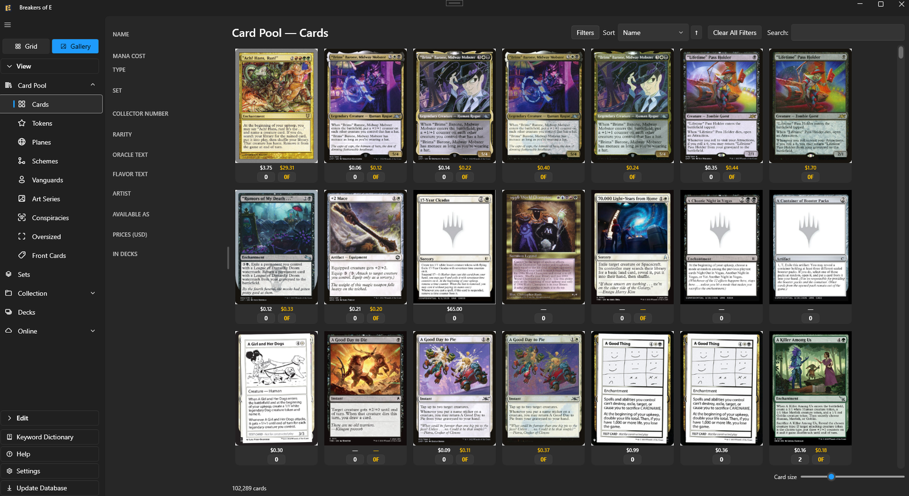
</p>

---

## What it does

Breakers of E (BoE) keeps track of every Magic card that exists, the cards you own, your decks, the cards you're trading and the cards you're looking for, with card data, prices and rulings from [Scryfall](https://scryfall.com).

### Card pool
- Every Magic card from Scryfall (100,000+ printings), loaded for instant browsing
- Separate pools for Tokens, Planes, Schemes, Vanguards, Art Series, Conspiracies, Oversized cards and Front Cards
- **MTGO and Arena** cards in their own tables (MTGO prices in tix)
- **Non-Foil, Foil and Etched** as real finishes, each with its own price
- **Update Database**: card data, prices, set and mana symbols, rulings, Scryfall's card tags, Commander Spellbook's combos and EDHREC's salt scores in one click, or prices only

### Sets
- Every release as a tile, with how much of it you own: the set together with its Commander decks, promos, tokens, art series and more
- A release's page shows each part with its own completion; open one for its cards, with **Missing Only** and the cards you don't own dimmed
- **Set Completion**: every set's progress, value and what's missing

<p align="center">
  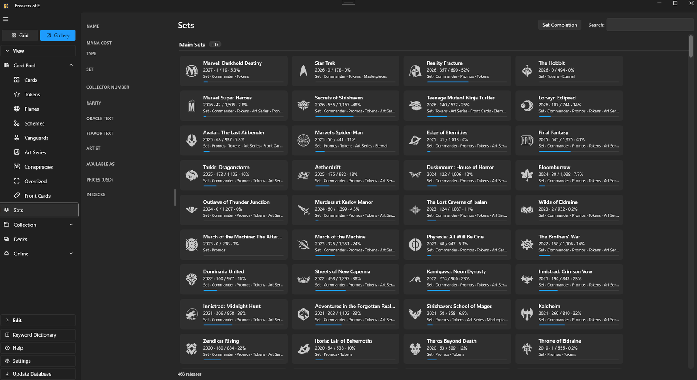
  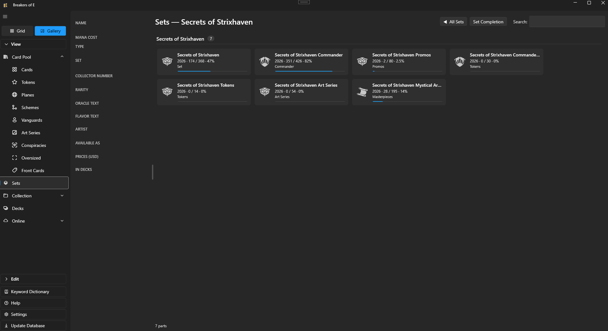
</p>

### Browsing
- **Grid and Gallery** views of every table
- Gallery pictures stay clean: underneath, each finish gets its own price and count (gold for foil and etched)
- Column filters, multi-level sort, saved column layouts and zoom
- A **Filters** panel: colors, rarity, type, legality, finish, artist, set, deck, rules text, and price, mana value, power and toughness ranges
- Card panel and card window: prices with a price chart, legality by format, rulings, card tags, salt score, links to EDHREC, Scryfall and Commander Spellbook, and every deck using the card
- Two-sided cards show each side, with a flip

### Collection
- One row per printing × finish × language × condition, with notes, storage location, favorites and price
- Add and remove with a Qty box, keys, right-click menus, or the **− / +** under each gallery picture, with **Undo**
- **Edit → Sets**: opened a pack, box or precon? Go down the set's pictures and click **+** on what you got; tokens and oversized cards go to their own collections by themselves
- Copies used by decks or the Trade Binder can't be removed by accident
- A finish you own that the card doesn't come in is flagged in amber (usually the wrong set picked)
- **Statistics**: counts, value, breakdowns, and **collection value over time**
- A backup of your collection before the first change each session

<p align="center">
  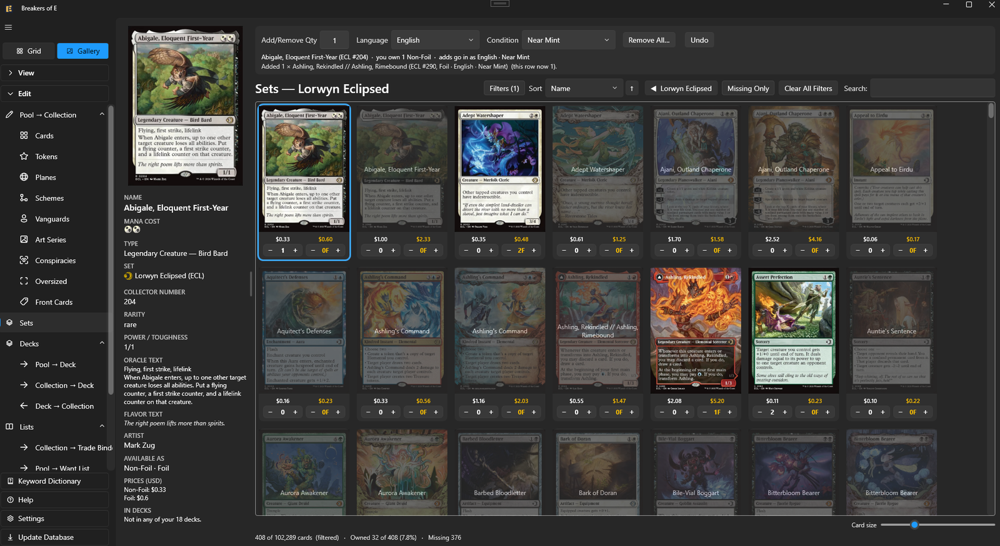
</p>

<p align="center">
  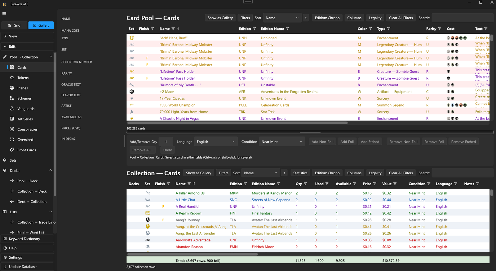
  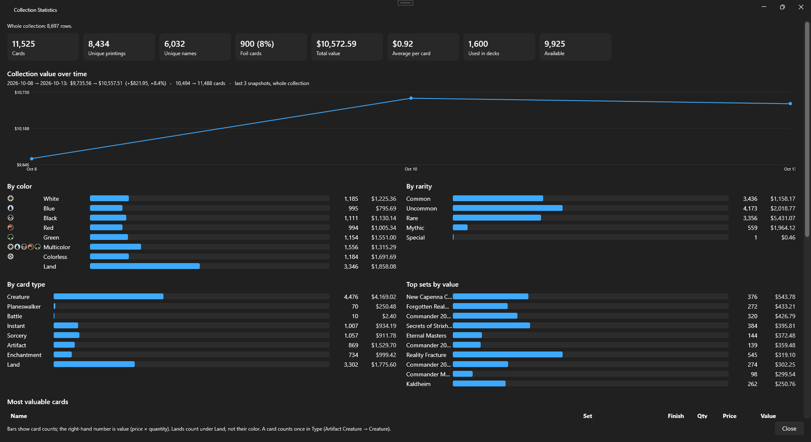
</p>

### Deck builder
- **Edit → Decks → Build** drafts a deck from the cards you own, and every card says why it's in
- **Commander** (partners and Backgrounds included) or **60-card** for the format you pick: Standard, Pioneer, Modern, Legacy, Vintage, Pauper and more
- Only your free copies, or your collection plus cards to get within a spend limit, with an optional cap on the deck's value
- Aims for the **Commander Bracket** you pick: Game Changers, two-card combos, land denial and extra turns
- A **guide** (lands, ramp, card draw, removal, board wipes …) you can change or switch off; 60-card decks get a **mana curve**, **key cards** and **plan words**
- Uses **EDHREC** for the commander, **Scryfall's card tags** for what cards do, and **Commander Spellbook** for combos
- **Guided Build**: pick the cards for each job yourself from the best options
- **What can I build?** ranks your commanders, partner pairs or color combinations by how much of a deck you already own
- Lock or exclude cards and build again; test hands before you commit
- **Accept** makes the deck: your free copies claimed, the rest on the Want List for it, **swap options** in the sideboard, its tokens offered
- **Rule 0 sheet** to share with your playgroup

<p align="center">
  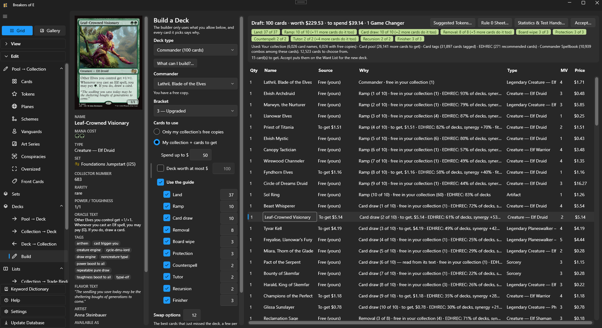
</p>

<p align="center">
  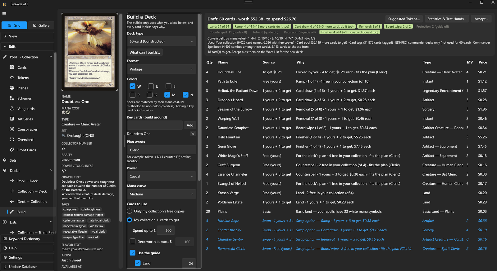
  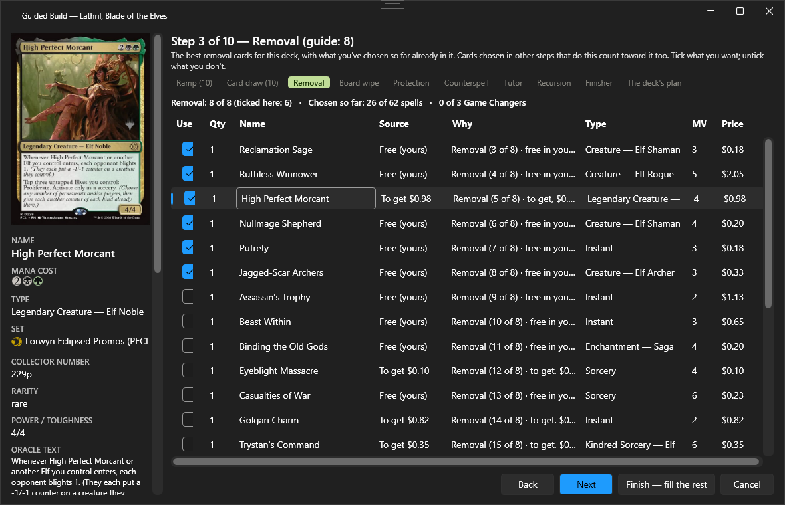
</p>

### Decks
- **Every format, with its real rules**: Standard, Pioneer, Modern, Legacy, Vintage, Pauper and more; Commander, Brawl, Standard Brawl, Pauper Commander, Duel Commander, Oathbreaker; Limited
- A live rules check: deck size, copy limits, sideboard, color identity, legality, and partner / Background / Oathbreaker pairing. It warns, it never blocks
- Build from the whole card pool or from the cards you own; the copies a deck uses are claimed so no other deck takes them
- Command zone, main deck, sideboard and tokens kept apart, with **Suggested Tokens**
- **Deck statistics**: mana curve, mana symbols vs. sources, value, Commander brackets (with a real two-card combo check), **combos** in the deck and one card away, **EDHREC** recommendations, the saltiest cards, **draw odds** and **sample hands**
- **Deck versions**: save a version with a note, compare any two, restore one
- The sideboard holds **swap options**: unclaimed until you move one into the deck
- Autosave, Undo, and **Tear Down** to free a deck's cards (it asks what to do with the deck's Want List cards)

<p align="center">
  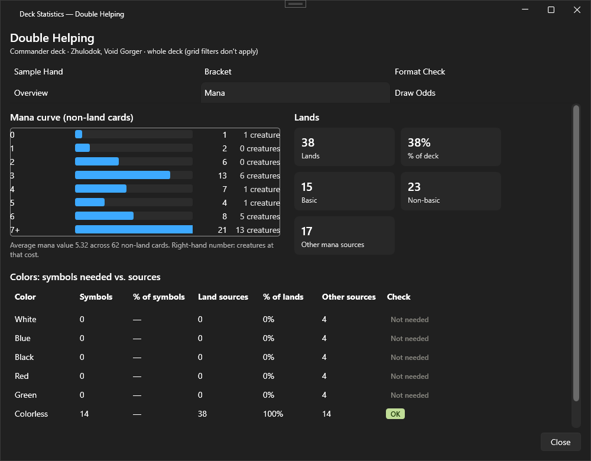
  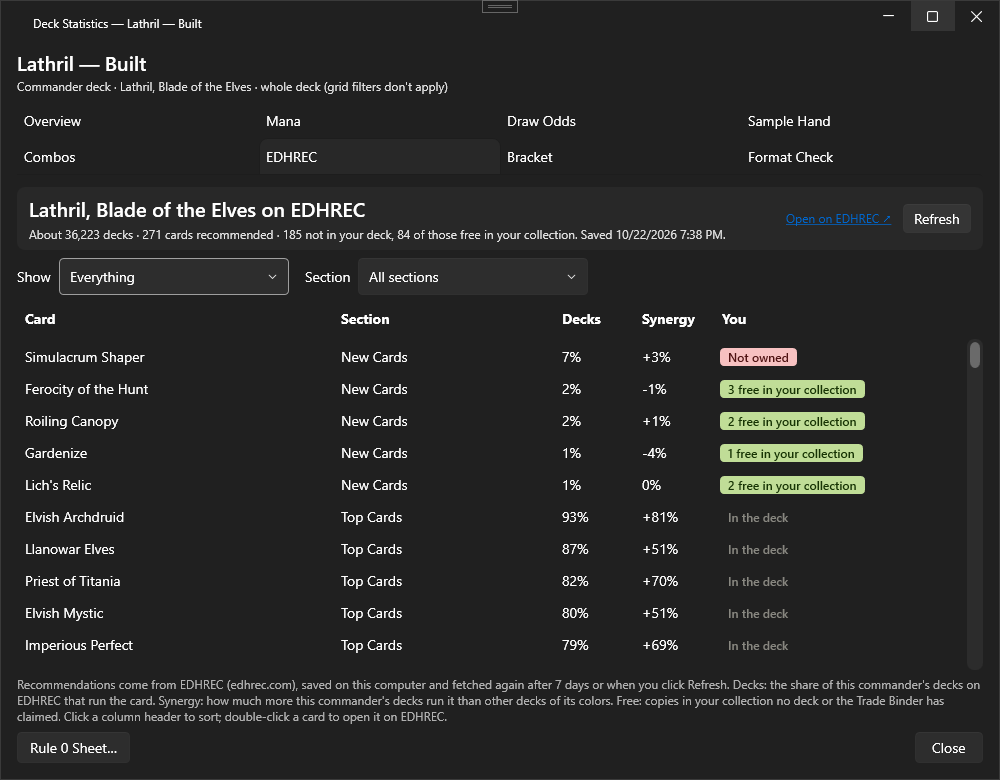
</p>

### Trade Binder and Want List
- **Trade Binder**: set copies aside to trade or sell, with Trade Value; **Traded / Sold** takes them out of your collection
- **Want List**: cards you're looking for, with an offer price, each **for** a deck or for your collection; add from the card pool, your collection or a deck's missing cards
- **Got It** puts the copies in your collection and claims them for the decks they were for

<p align="center">
  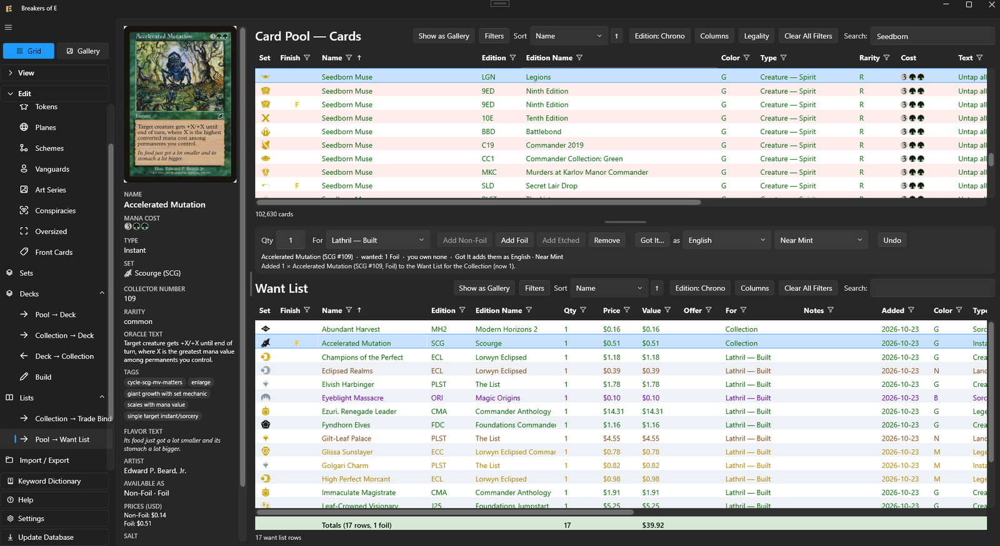
</p>

### Import and export
- Import from **ManaBox**, **Moxfield, Archidekt, Deckbox, TCGplayer, Dragon Shield, MTGGoldfish, Deckstats, Delver Lens** CSVs, or a plain **text list**, into your collection, Want List or a new deck, with a preview of every line and **Undo Last Import**
- **MTGO and Arena**: MTGO .dek and CSV files (matched exactly by MTGO id, foils included) and Arena lists into your online collections
- Export a text list (for Moxfield, Archidekt, MTG Deck Tools…), a ManaBox CSV, a spreadsheet CSV, or a **BoE full backup**
- Send a deck to **Arena** (paste into its Import) or **MTGO** (.dek); cards are swapped for a printing that game has, and anything it doesn't have is listed

<p align="center">
  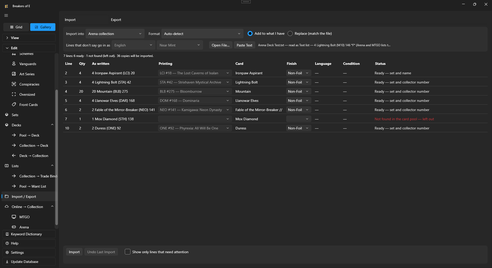
</p>

### And more
- **Keyword Dictionary**: what every keyword means, the official rules, and the cards that have it
- **Print slips**: token slips from a deck's Suggested Tokens, and card slips marked **PROXY**
- **Card pictures offline**: keep the pictures of your own cards, or download them all
- **Themes**: Dark, Light, Follow Windows, or your own colors
- **Help** for every page (press F1) and a **Program Tour**
- Lets you know when a new version is out

---

## Download and install

1. Go to the [latest release](https://github.com/georgebrun/repos/releases/latest) and download **BreakersOfE_Setup_v2.x.x.exe**.
2. Run it. No administrator rights are needed.
3. Start Breakers of E. The first time, it downloads the card data by itself. That takes a few minutes, and an internet connection.

Your data is kept in **Documents\Breakers of E**. You can move it later in **Settings → Data folder**.

### System requirements
- Windows 10 or 11 (64-bit or 32-bit)
- An internet connection for card data, prices and pictures
- A few hundred MB for the card data, plus the card pictures you choose to keep (several GB for all of them)

---

## Coming from v1

**Version 2 replaces v1, and v1 is no longer supported.**

- Setup installs v2 over v1. Before anything is changed, it tells you v1 is being replaced; **Cancel** there leaves v1 as it was.
- The first time v2 starts, it converts your collection, Trade Binder, Want List and the cards your decks use. Every card is counted before and after converting; if anything doesn't match, your v1 files are put back.
- Your v1 files are kept, exactly as they were, in **Documents\Breakers of E\v1 Backups**.
- Your decks, filters and card pictures stay where they are; v2 reads them.
- v1 couldn't tell foil from etched. After the first card data update, printings that only come in etched are set to etched for you, and a **Foil or Etched?** list asks about the ones that come in both.
- v1's settings aren't carried over. v2 starts with its own.

---

## Your data

Everything BoE saves is in one folder, **Documents\Breakers of E** unless you moved it:

| | |
|---|---|
| `Collection\collection.db` | Your collection, Trade Binder, Want List, tokens and online collections |
| `Collection\PriceHistory.db` | The prices saved with each update |
| `Decks` | One `.deck` file per deck |
| `Deck Versions` | Saved versions of each deck |
| `Deleted Decks` | Decks taken apart with Tear Down (copy one back to restore it) |
| `Backups` | Copies of `collection.db`: before the first change each session, and before every Replace import |
| `breakersofe.db`, `rulings.db` | The card data and rulings (downloaded again any time) |
| `tags.db`, `combos.db`, `EDHREC` | Card tags, combos, salt scores and saved EDHREC pages (downloaded again any time) |

To back up, close BoE and copy the whole folder, or use **Edit → Import / Export → BoE full backup**.

---

## Building from source

1. Open `BreakersOfE_v2/BreakersOfE_v2.sln` in **Visual Studio 2022** with the **.NET desktop development** workload (.NET 8 SDK).
2. Set **BreakersOfE** as the startup project, then build and run.

To make the installer:
1. Run `Installer\Publish_v2.bat` (publishes x64 and x86).
2. Open `Installer\BreakersOfE_Setup_v2.iss` in **Inno Setup 6** and compile. The setup file goes to `Installer\Output`.

### Project structure
```
BreakersOfE_v2.sln
├── BreakersOfE.DeckBuilder — the deck builder's engine (plain .NET, no database or screens)
├── BreakersOfE.Core        — shared library: models, data (EF Core + SQLite), services
└── BreakersOfE             — the WPF app (WPF-UI): views, view models, Help topics
BreakersOfE_v1              — v1, kept for reference (no longer supported)
Installer                   — publish script and Inno Setup scripts
```

---

## Credits

Card data, prices, rulings, card tags and images are provided by [Scryfall](https://scryfall.com). Combos come from [Commander Spellbook](https://commanderspellbook.com). Commander recommendations and salt scores come from [EDHREC](https://edhrec.com). Breakers of E is not affiliated with Scryfall, Commander Spellbook or EDHREC.

Breakers of E is unofficial Fan Content permitted under the [Fan Content Policy](https://company.wizards.com/en/legal/fancontentpolicy). Not approved/endorsed by Wizards. Portions of the materials used are property of Wizards of the Coast. ©Wizards of the Coast LLC.

---

© George Brun. All rights reserved.
